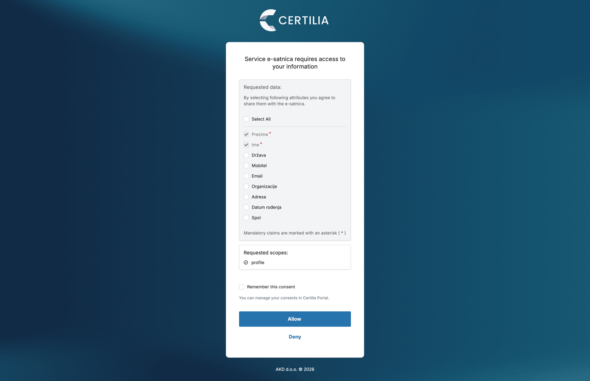

# Certilia: koje podatke tražimo i zašto

Stanje 28. 10. 2026. Ovo nije pravno mišljenje; prije puštanja javnosti treba ga
potvrditi pravnica (vidi „Za pravnicu" na kraju).

## Pravila koja vrijede za svaki podatak

- **Ograničenje svrhe** (GDPR čl. 5(1)(b)): svrha se navodi unaprijed, za svaki podatak.
- **Smanjenje količine podataka** (čl. 5(1)(c)): skuplja se samo ono što je nužno za tu svrhu.
- **Pravna osnova** (čl. 6): za svaku svrhu. Privola mora biti konkretna, a ne „sve odjednom".

ZEF smije tražiti puni KYC jer ima zakonsku obvezu dubinske analize stranke
(Zakon o sprječavanju pranja novca i financiranja terorizma). E-satnica takvu
obvezu nema. Opravdanje „integracija s drugim aplikacijama" samo po sebi nije
svrha; svrha je konkretna funkcija koju korisnik koristi.

Dvije okolnosti čine nas osjetljivijima od prosječne aplikacije:

1. **Most je politička stranka.** Ako je aplikacija vidljivo Mostova, podatak da
   netko nastavnik koristi e-satnicu mogao bi se tumačiti kao podatak o političkom
   mišljenju (čl. 9, posebna kategorija). Što manje podataka, to manji rizik.
2. **Bodovanje i raspodjela radnih mjesta** su automatizirane odluke sa značajnim
   učinkom na zaposlenike javnog sektora (čl. 22), u velikom opsegu. To gotovo
   sigurno traži procjenu učinka (DPIA, čl. 35) prije javnog puštanja.

## Dvije liste u Certilijinoj formi

| Lista | Što znači | Posljedica |
|---|---|---|
| **Want to receive** | najviše što aplikacija smije tražiti; korisnik pristaje po stavci | stavka koju korisnik odbije jednostavno ne stigne |
| **Mandatory** | bez pristanka na ovo prijava **pada** | svaka nepotrebna stavka ovdje zaključava ljude van |

Uz to aplikacija u svakoj prijavi kroz `claims` parametar traži samo podskup
(`src/lib/certilia/oidc.ts`, `CLAIMS_REQUEST`). Koliko Certilijin ekran za
pristanak prati taj podskup, a koliko registraciju, provjeriti na prvoj prijavi.

## Polje po polje

Ocjena: **da** = opravdano odmah · **kasnije** = opravdano tek kad funkcija postoji ·
**slabo** = svrha postoji, ali se postiže i bez toga · **ne** = nema svrhe.

| Polje | Svrha u e-satnici | Pravna osnova (prijedlog) | Ocjena | Mandatory | Traži kod | Spremamo |
|---|---|---|---|---|---|---|
| **OIB/PIN** | jedna osoba = jedan račun; nema lažnih ni dvostrukih unosa u bodovanju i zamjenama | legitimni interes (čl. 6(1)(f)) | da | **da** | da | samo HMAC otisak, nikad OIB |
| **First name** | tko je što napisao, prijavio ili zatražio; prikaz na listi | legitimni interes | da | **da** | da | da |
| **Last name** | isto | legitimni interes | da | **da** | da | da |
| **Birthdate** | dob je kriterij bodovanja (1 ili 2 boda po godini, vidi specifikaciju) | privola ili ugovor (korisnik traži bodovanje) | kasnije | ne | da | ne, dok ne postoji bodovanje |
| **Address** | prebivalište za pravilo 50 km; županijske liste ga već vode | privola ili ugovor | kasnije | ne | ne | ne, dok ne postoji raspodjela |
| **Email** | obavijesti (nova ponuda, potvrda zamjene, istek roka za prigovor) | privola | kasnije | ne | da | ne, dok ne postoje obavijesti |
| **Mobile** | SMS ili WhatsApp obavijest o zamjeni; mnogi nastavnici nisu na mreži preko maila | privola | slabo | ne | ne | ne |
| **Organization** | **ravnatelj**: Certilia s poslovnim certifikatom vraća pravnu osobu koju korisnik zastupa (OIB tvrtke u `vat`). Škola je pravna osoba s OIB-om, pa to dokazuje da je osoba ovlaštena prijaviti slobodne sate i viškove te škole | legitimni interes | kasnije | ne | ne | samo naziv i OIB škole |
| **Country** | svi korisnici su u HR sustavu; nema funkcije koja ovisi o tome | — | ne | ne | ne | ne |
| **Gender** | jedina ideja je gramatički rod u sučelju („prijavljen/prijavljena"); to se rješava neutralnim tekstom | — | ne | ne | ne | ne |
| **Photo** | nema; avatar nije potreban, a fotografija s osobne je osjetljiv podatak | — | ne | ne | ne | ne |
| **Document type** | nema; identitet je već dokazan Certilijom | — | ne | ne | ne | ne |
| **Document number** | nema; isto | — | ne | ne | ne | ne |
| **Document issuing country** | nema | — | ne | ne | ne | ne |
| **Document expiration date** | nema | — | ne | ne | ne | ne |

## Usporedba: sada i kad funkcija postoji

Za svako polje: najjača funkcija koja bi ga mogla opravdati i kada ga uključujemo.
Polje se uključuje tek kad ta funkcija uđe u specifikaciju, ne unaprijed.

| Polje | Treba sada? | Moguća buduća funkcija | Uvjet za uključivanje | Rizik ako ga skupljamo bez funkcije |
|---|---|---|---|---|
| OIB/PIN | da | — | — | — |
| First name, Last name | da | — | — | — |
| Birthdate | ne | bodovanje (dob) | bodovna tablica potvrđena s pravnicom | nizak; datum rođenja je čest podatak |
| Address | ne | pravilo 50 km, izračun udaljenosti do škole | modul raspodjele i zamjena | srednji; adresa + OIB + stranka |
| Email | ne | obavijesti o ponudama, zamjenama i rokovima | obavijesti u specifikaciji | nizak |
| Mobile | ne | SMS/WhatsApp obavijest kad se nađe par za zamjenu | odluka da obavijesti idu i SMS-om | srednji; mobitel je izravan kontakt |
| Organization | ne | uloga ravnatelja: dokaz da zastupa školu (OIB škole) | modul za ravnatelje; provjeriti s poslovnim certifikatom | nizak; registarski podaci su javni |
| Gender | ne | anonimna statistika: pogađaju li viškovi više žene (razredna nastava) | statistika u specifikaciji, samo agregirano | srednji; bez funkcije nema obrane |
| Country | ne | nastavnici sa stranom ispravom ili diplomom | pokaže li se da takvih ima u sustavu | nizak |
| Photo | ne | profilna slika u „društvenoj mreži nastavnika" iz vizije | ta mreža postoji i korisnik sam bira sliku | **visok**; fotografija s osobne, korisnik je može i sam učitati |
| Document type, number, issuing country, expiration date | ne | nema: identitet je dokazan prijavom, a mi nemamo obvezu KYC-a kao ZEF | zakonska obveza identifikacije, koju e-satnica nema | **visok**; to je upravo podatak koji se zloupotrebljava za krađu identiteta |

Zbirno: **3 polja odmah, 6 kasnije uz konkretnu funkciju, 5 nikad** dok se ne
pojavi zakonska obveza. Proširenje forme traje minutu, a opravdanje se ne može
naknadno dopisati podacima koji su već skupljeni.

## Kompromis: široka registracija, uzak zahtjev, step-up

Problem koji izbjegavamo: 10.000 korisnika je unutra, a funkciji zatreba polje
koje nije u registraciji kod Certilije. Ako promjena produkcijske registracije
traži odobrenje AKD-a, to može trajati tjednima (nepotvrđeno).

Zato su tri razine odvojene:

| Razina | Gdje | Što sadrži | Mijenja se |
|---|---|---|---|
| **Gornja granica** | Certilia forma, „Want to receive" | sve s realnom budućom funkcijom (9 polja) | jednom, sada |
| **Obavezno** | Certilia forma, „Mandatory" | samo identitet: `pin`, `firstname`, `lastname` | nikad |
| **Stvarni zahtjev** | kod, `claims` parametar | osnovna prijava: OIB, ime, prezime | uz svaku novu funkciju |
| **Step-up** | `/auth/certilia/start?trazi=…` | podatak koji funkcija treba, u trenutku kad ga treba | — |

Polje u gornjoj granici koje kod ne traži i ne sprema nije prikupljeno. Obrađuje
se tek kad ga funkcija zatraži step-upom, s obaviješću korisniku zašto.

Zašto naknadno dohvaćanje nije katastrofa:

- Sesija traje 30 dana i refresh token ne koristimo, pa se svi ionako redovno
  ponovno prijavljuju Certilijom; nitko ne mora biti „prisiljen".
- Step-up traži podatak jednim klikom kad korisnik otvori funkciju koja ga treba
  (npr. bodovanje → datum rođenja). Pristanak je tada razumljiv i čvršći.
- Adresa mora biti svježa pri zaključavanju raspodjele (oko 15. kolovoza), pa bi
  adresa iz onboardinga ionako bila zastarjela. `korisnik_podaci.dohvaceno_at`
  govori koliko je podatak star.

### Kako funkcija traži podatak

```ts
import { stepUpUrl } from '../lib/certilia/oidc';
// nema datuma rođenja u korisnik_podaci → pošalji korisnika po njega
return Astro.redirect(stepUpUrl(['birthdate'], '/bodovi'));
```

Dopušteni podaci (`STEP_UP` u `src/lib/certilia/oidc.ts`): `birthdate`, `address`,
`email`, `mobile`, `organization`, `gender`, `country`. Sve ostalo se odbacuje.
Spremaju se u `korisnik_podaci` samo podaci zatraženi u tom step-upu.

## Što označiti u Certilijinoj formi (konačno)

**User data your application want to receive:**
Email, First name, Last name, OIB/PIN, Birthdate, Address, Country, Mobile,
Gender, Organization.

**Ne označavati:** Photo, Document type, Document number, Document issuing
country, Document expiration date. Za njih nema ni buduće svrhe, a to su upravo
podaci za krađu identiteta.

**Mandatory user data your application require:** `pin`, `firstname`, `lastname`.

### Izmjereno na prvoj prijavi (28. 10. 2026., debug)



- Ekran prikazuje **cijelu gornju granicu** iz registracije, ali dobrovoljna polja
  su **neoznačena**; obavezna (`*`) su samo Ime i Prezime. Korisnik ne dijeli ništa
  dodatno ako sam ne označi. Kod ionako sprema samo ono što je tražio step-upom.
- OIB se na ekranu ne prikazuje i `pin` claim nije stigao, iako je u Mandatory.
  Stigli su: `sub`, `given_name`, `family_name` (+ standardni `acr`, `amr`, `aud`,
  `iss`, `sid`…). OIB se uzima iz `sub` (`oibIzTokena`), kao što je ZEF izmjerio.
- **Certilia pamti pristanak na podatke** iz prve prijave, iako „Remember this
  consent" nije označen: druga prijava pita samo za scope (`profile`) i dobrovoljna
  polja više ne nudi. Zato step-up šalje `prompt=login consent`; tada se izbor
  podataka ponovno prikaže (provjereno istog dana). Osnovna prijava ostaje
  `prompt=login`, jednim klikom.

Za upute korisnicima: dovoljno je kliknuti **Allow**; kvačice ispod Imena i
Prezimena ne treba dirati.

## Za pravnicu

1. Je li legitimni interes dovoljan za OIB (otisak) i ime, ili treba privola?
2. Treba li DPIA i u kojem trenutku: za prototip na fiktivnim podacima, ili tek pri javnom puštanju?
3. Čl. 22: je li bodovanje u paralelnom sustavu (bez pravnog učinka) „automatizirana odluka"?
4. Tko je voditelj obrade: Most, udruga, fizička osoba? Treba li odvojiti e-satnicu od stranke?
5. Smije li se `Organization` claim koristiti kao dokaz da je osoba ravnatelj škole?

### Izmjereno na step-upu (28. 10. 2026., prave prijave)

- **Certilia šalje sve što korisnik označi, bez obzira na `claims` zahtjev.** E-mail je
  stigao iako ga nismo tražili. Filtriranje je na našoj strani: callback sprema samo
  podatke zatražene u tom step-upu. Na Certiliju se kao zaštitu ne oslanjamo.
- **`essential: true` za step-up claim Certilia ignorira**: polje nije predoznačeno.
  Predoznačena (sa `*`) su samo polja iz Mandatory u registraciji. Zato postoji naša
  međustranica `/dopuna`, koja kaže zašto i koju kvačicu označiti.
- `birthdate` → spremljeno kao `YYYY-MM-DD` (10 znakova). `formatted` (adresa) stiže
  kao niz od 3 retka → spremljeno kao jedan red s dva zareza.
- Ista osoba u tri prijave = jedan zapis u `korisnici` (stabilan otisak OIB-a iz `sub`).
  Je li `sub` doista 11-znamenkasti OIB, još nije potvrđeno (debug kartica).

**Otvorena odluka:** adresa kao Mandatory bi je predoznačila, ali bi je tražila od
svakoga pri svakoj prijavi, a tko odbije, ne ulazi. Preporuka: Mandatory tek kad
modul raspodjele (pravilo 50 km) postane stvaran; do tada `/dopuna`. Step-up
claimovi su od 28. 10. opet `null`; `essential` ostaje samo na `pin`.

## Tijek prijave za upute korisnicima

Javna stranica s ovim koracima: `/upute` (`src/pages/upute.astro`, izrezane slike u `public/upute/`).

1. Certilia prijava (e-mail ili OIB i lozinka): `slike/certilia-1-prijava.png`
2. Potvrda u aplikaciji Certilia mobileID na mobitelu: `slike/certilia-2-mobileid.png`
3. Pristanak na podatke: Ime i Prezime su obavezni, ostalo ne treba dirati, klik na
   **Allow**: `slike/certilia-3-pristanak-prva-prijava.png`. Kod step-upa
   (npr. datum rođenja za bodovanje) isti ekran, s uputom koju kvačicu označiti:
   `slike/certilia-3-pristanak-step-up.png`.
