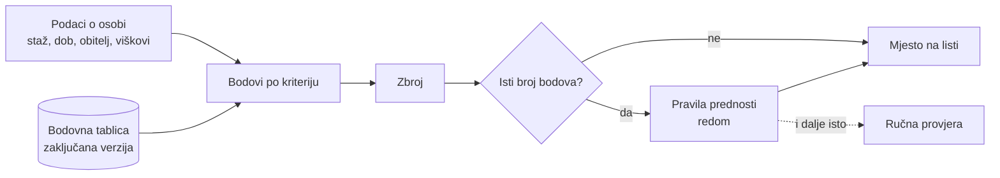

> **Nacrt v0.** Napravljen iz 1. sastanka, županijskih lista SDŽ i rasprave u grupi. Nije pravno provjeren; pravila za izmjene zakona, pravilnika i kolektivnih ugovora priprema pravnica. Komentiraj ispod.

Bodovna tablica mora biti javna i zaključana **prije** izračuna. Sudovi u Italiji i Indiji rušili su raspodjele kad nije bila. Zato je tablica verzionirana: nacrt je `v0-nacrt`, a kad se zaključa postaje `v1` i više se ne mijenja. Svaka promjena je nova verzija, pa se svaki stari izračun može ponoviti.

## Kako se računa

Bodovi su zbroj kriterija iz tablice ispod. To je obična funkcija, ne stroj stanja: isti podaci uvijek daju iste bodove, pa svatko može sam provjeriti svoje mjesto.

- Broje se **navršene** godine. Godine se računaju na dan zaključavanja liste.
- Neispravan podatak (negativan broj, prazno polje) zaustavlja izračun umjesto da tiho da krivi zbroj.
- Uz zbroj se uvijek prikazuje i **raspis po kriterijima**, da osoba vidi odakle joj bodovi.

## Zašto ne županijsko bodovanje

U županijskoj tablici dob nosi većinu bodova: osoba od 42 godine dobije 84 od ukupno 109. Na OŠ listi SDŽ ručni zbroj je pogrešan u 6 od 120 redaka, što je argument za automatski izračun. Kriteriji za invaliditet, dijete s teškoćama i prethodne viškove postoje u pravilniku, ali ne i u objavljenoj tablici.

Kolektivni ugovori za osnovne i srednje škole su različiti. Nacrt predlaže **iste kriterije za oba**, jer se isti predmeti predaju u oba.

## Što sustav još mora znati

- **Normu po predmetu**, npr. hrvatski 20, povijest 22 sata nastave. Županijske liste računaju u tjednim radnim satima od 40, pa sustav mora preračunavati.
- **Trajanje** ponude: određeno ili neodređeno, i koliko dugo.
- **Kako se dokazuje** svaki kriterij i gdje se dokaz predaje.
- Rad u **više škola** istovremeno; na županijskoj listi neki rade u četiri.
