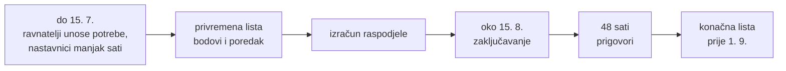
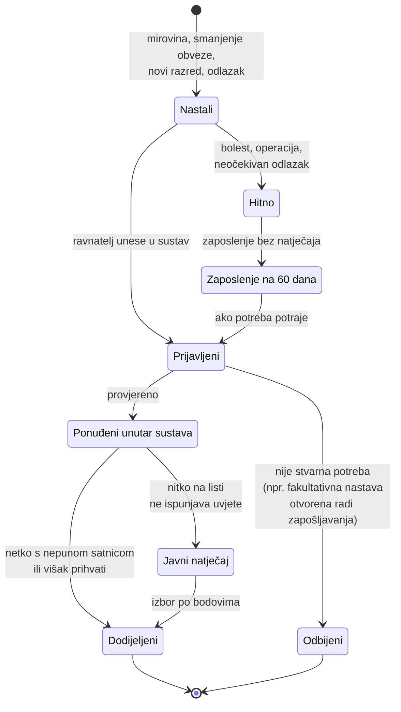
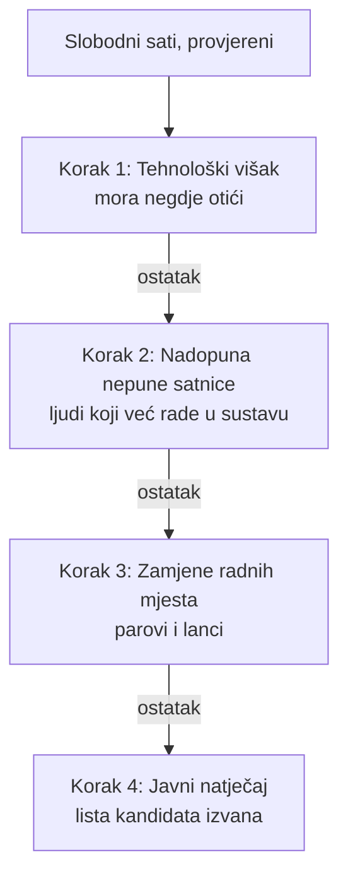

> **Nacrt v0.** Pravila ispod su prijedlog iz rasprave tima, ne važeći propis. Neka traže izmjenu zakona ili pravilnika; to priprema pravnica.

## Godišnji ciklus

1. **Prijava do 15. srpnja:** ravnatelji unose sve slobodne sate i viškove za iduću školsku godinu, nastavnici svoje podatke, satnicu i koliko im sati fali do pune norme. Što treba 1. rujna, zna se sredinom srpnja.
2. **Privremena lista:** sustav izračuna bodove i objavi poredak.
3. **Izračun raspodjele:** redoslijed je ispod.
4. **Zaključavanje oko 15. kolovoza.**
5. **48 sati za prigovore.** Rješava neovisna komisija (županija i sindikat).
6. **Konačna lista** i objava.

## Životni put slobodnih sati

Svaki slobodni sat ima stanje. Prijelaz između stanja je javan i zapisuje se s vremenom, pa se vidi kad je škola znala za potrebu i kad ju je prijavila.

Pravila:

- **Svi slobodni sati se prijavljuju**, i oni koji nastanu kad netko nakon 30 godina staža dobije 2 sata manje tjedne obveze. Ti sati idu onome tko je prvi na listi, a ne novom zaposleniku na malu satnicu.
- **Fakultativna nastava nije potreba za zapošljavanjem.** Danas se otvori 2 sata fakultativne nastave, na njih se zaposli nova osoba, a kad stariji kolega ode u mirovinu, toj se osobi nadopuni satnica. Ljudi koji godinama rade na nepunoj satnici ili na zamjenama tada ostaju bez tih sati.
- **Zaposlenje na 60 dana bez natječaja samo za hitne slučajeve**, ne za potrebe koje su bile poznate u srpnju. Natječaj koji izađe nakon tih 60 dana danas je pro forma: mjesto je već popunjeno.
- Prijava kasnije od roka je vidljiva kao **kasna prijava**, s datumom kad je potreba nastala.

## Redoslijed raspodjele

Prvo se zbrinjavaju oni koji su već u sustavu, tek onda novi. Na svakom koraku ide se po bodovima, unutar 50 km, za isti predmet i normu; što ostane, ide na idući korak.

## Pravila

- Nastavnik mora prihvatiti posao do **50 km** udaljenosti; iznad toga ne mora. Udaljenost se računa cestom, ne zračnom linijom.
- Rezultat izračuna je determinističan: isti ulaz uvijek daje isti izlaz, pa se svaka odluka može provjeriti.
- Izlaz se provjerava prije objave. Portugal je 2025. nastavnike smjestio u škole za koje se nisu prijavili.

## Mehanizam (prijedlog)

Bodovi određuju prioritet, a raspodjela ide stabilnim sparivanjem u dvije faze, prvo županija pa škola, po uzoru na Francusku.
