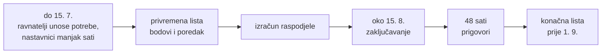
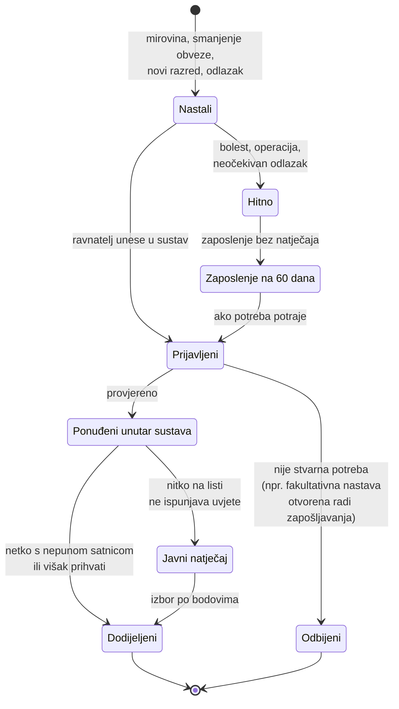
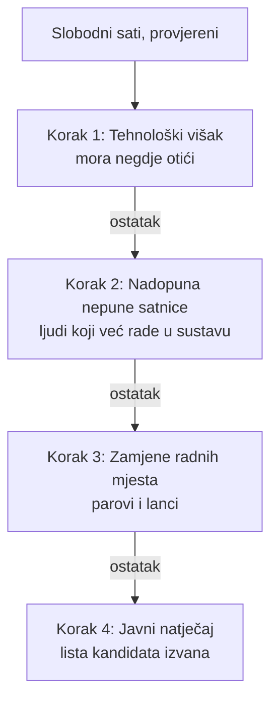

> **Nacrt v0.** Pravila ispod su prijedlog iz rasprave tima, ne važeći propis. Neka traže izmjenu zakona ili pravilnika; to priprema pravnica.

## Godišnji ciklus

1. **Prijava do 15. srpnja:** ravnatelji unose sve slobodne sate i viškove za iduću školsku godinu, nastavnici svoje podatke, satnicu i koliko im sati fali do pune norme. Što treba 1. rujna, zna se sredinom srpnja.
2. **Privremena lista:** sustav izračuna bodove i objavi poredak.
3. **Izračun raspodjele:** redoslijed je ispod.
4. **Zaključavanje oko 15. kolovoza.**
5. **48 sati za prigovore.** Rješava neovisna komisija (županija i sindikat).
6. **Konačna lista** i objava.

## Životni put slobodnih sati

Svaki slobodni sat ima stanje. Prijelaz između stanja je javan i zapisuje se s vremenom, pa se vidi kad je škola znala za potrebu i kad ju je prijavila.

Pravila:

- **Svi slobodni sati se prijavljuju**, i oni koji nastanu kad netko nakon 30 godina staža dobije 2 sata manje tjedne obveze. Ti sati idu onome tko je prvi na listi, a ne novom zaposleniku na malu satnicu.
- **Fakultativna nastava nije potreba za zapošljavanjem.** Danas se otvori 2 sata fakultativne nastave, na njih se zaposli nova osoba, a kad stariji kolega ode u mirovinu, toj se osobi nadopuni satnica. Ljudi koji godinama rade na nepunoj satnici ili na zamjenama tada ostaju bez tih sati.
- **Zaposlenje na 60 dana bez natječaja samo za hitne slučajeve**, ne za potrebe koje su bile poznate u srpnju. Natječaj koji izađe nakon tih 60 dana danas je pro forma: mjesto je već popunjeno. Prema navodu iz rasprave, ta je mogućnost uvedena kad je bilo teško naći nastavnike deficitarnih predmeta (fizika, matematika), da nastava ne stane; pravnica to treba potvrditi (otvoreno pitanje 20).
- Prijava kasnije od roka je vidljiva kao **kasna prijava**, s datumom kad je potreba nastala.

**Otvoreno: nadopuna unutar iste škole.** Ravnatelj danas nepuno radno vrijeme svog zaposlenika može proširiti do punog bez natječaja (prema našem čitanju čl. 107. Zakona o odgoju i obrazovanju u osnovnoj i srednjoj školi). U raspravi 31. 10. rečeno je da ravnatelj u sustav prijavljuje sate koji ne trebaju za nadopunu nikome tko je već zaposlen u toj školi.

To se ne slaže s prvim pravilom iznad, po kojem se prijavljuju svi sati. Ista je prednost i put kojim mala satnica kasnije naraste do pune: osoba zaposlena na 2 sata fakultativne nastave postaje „netko iz škole". Treba odlučiti (otvoreno pitanje 17):

- ide li nadopuna unutar škole prije županijske liste po bodovima ili je dio koraka 2 u redoslijedu ispod,
- prijavljuju li se javno i sati koji ostaju u školi.

## Redoslijed raspodjele

Prvo se zbrinjavaju oni koji su već u sustavu, tek onda novi. Na svakom koraku ide se po bodovima, unutar 50 km, za isti predmet i normu; što ostane, ide na idući korak.

## Pravila

- Nastavnik mora prihvatiti posao do **50 km** udaljenosti; iznad toga ne mora. Udaljenost se računa cestom, ne zračnom linijom.
- Rezultat izračuna je determinističan: isti ulaz uvijek daje isti izlaz, pa se svaka odluka može provjeriti.
- Izlaz se provjerava prije objave. Portugal je 2025. nastavnike smjestio u škole za koje se nisu prijavili.

## Mehanizam (prijedlog)

Bodovi određuju prioritet, a raspodjela ide stabilnim sparivanjem u dvije faze, prvo županija pa škola, po uzoru na Francusku.

## Anonimnost (prijedlog iz rasprave, 31. 10. i 5. 11.)

Prijedlog: prijave i raspodjela vode se anonimno, i za ljude i za škole i za sate, po uzoru na Italiju (navod iz rasprave). To bi bila razlika prema HZZ-u i ostalim postojećim sustavima.

Nije dogovoreno što to točno znači: tko je anoniman prema kome i do kojeg trenutka. To treba pomiriti s javnom listom po bodovima, na kojoj svatko mora moći provjeriti svoje mjesto (otvoreno pitanje 18).

## Što sustav može prije izmjene propisa

Dio pravila iznad traži izmjenu zakona ili pravilnika. Dok se to ne dogodi, sustav je dobrovoljan i paralelan. Prema raspravi tima (31. 10. i 5. 11.), i bez izmjene propisa može:

- na jednom mjestu povezati škole koje trebaju sate s nastavnicima kojima sati fale,
- pokazati tko po bodovima ima prednost i gdje sati stvarno trebaju,
- pokazati **kad** je potreba prijavljena, pa se vidi je li prijavljena na vrijeme ili tek kad netko na tom mjestu već radi,
- pokazati koliko se ljudi javilo na pojedino mjesto, ako se prijave vode kroz sustav.

Tek s izmjenom propisa prijava svih potreba do roka postaje obvezna, a zapošljavanje na sate koji nisu stvarna potreba prestaje biti moguće.

**Otvoreno:** što pošten ravnatelj dobiva u e-satnici, a danas ne može postići objavom natječaja na HZZ-u i stranici škole već u srpnju (otvoreno pitanje 21).
